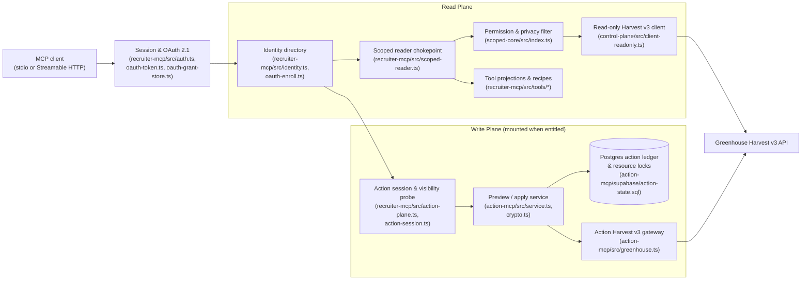

# Greenhouse MCP

Recruiters want to ask an AI assistant the questions they ask every week — where candidates are stalling on their requisitions, which interviewers are late with scorecards, which sources actually produce hires — and to hand it clerical work like moving a candidate to the next stage. Connecting an assistant to Greenhouse makes that risky by default. Greenhouse's API — its data connection — grants read access at the site-admin level and filters nothing per recruiter, so a thin assistant built on it would show every recruiter every candidate, compensation field, private note, and confidential requisition. An assistant that edits records on a conversational "yes" can also overwrite a teammate's change or apply the same move twice.

Greenhouse MCP connects AI assistants such as Claude and Cursor to Greenhouse through the Model Context Protocol — the interface through which an assistant calls read and write tools — and holds the lines a careful recruiting-operations lead would hold. Each recruiter sees only what their own Greenhouse permissions allow, and pipeline numbers are computed by the server rather than estimated by the model. Every change is shown first as a preview the recruiter confirms, rechecked against live Greenhouse data when it is applied, and sent once. The system exposes 82 read tools and 13 kinds of write, and its 2,536 tests run without Greenhouse credentials.

I use Greenhouse MCP not mainly to ask an assistant questions, but as the foundation for background recruiting agents built to own whole workflows such as end-to-end recruitment coordination. Today, a read-only scheduling agent runs every 30 minutes on my desktop for one open role, reading Gmail, Google Calendar, Slack, and Greenhouse to track every interview being arranged — a hiring manager confirming a time, a candidate sending availability or accepting an invite, an interviewer yet to respond — and writing up the next step for my approval without sending messages or changing records. In working sessions, my agents have moved candidates between stages and recorded nine rejections on 13 October 2026 after I approved each preview, with every change noting that my assistant acted. Each kind of action earns the right to run on its own only after a clean record, and that trust is possible because the agents see only what my Greenhouse permissions allow and change nothing without a preview I confirm.

<!-- METRIC: number of recruiters using it, or questions answered per week, if Sam supplies it -->

I am a recruiter, not a software engineer, and I built this by directing AI coding agents against written specifications, adversarial reviews, and live verification against the Greenhouse API.

> Curated public snapshot as of 15 October 2026. Private development history, tenant-specific configuration, and deployment-specific artifacts are omitted.

## System architecture and design choices



### Per-recruiter permission scoping and mechanical read/write separation

A recruiter working on engineering requisitions should never see candidates on an executive search, a confidential requisition they are not assigned to, or private compensation fields, even though Greenhouse Harvest v3 requires a Site Admin credential on list endpoints and returns unfiltered organization-wide rows. Every recruiter read passes through `createScopedGreenhouseReader`, which strips model-supplied identity parameters (`actor_id`, `on_behalf_of_user_id`, `actAsUser`), resolves the caller's live permissions from `/v3/user_job_permissions`, `/v3/user_roles`, and `/v3/users` (cached for at most 60 seconds by default), withholds unattested private candidates (`candidate.is_private`) and private custom fields, and denies any tool absent from `DEFAULT_FILTER_REGISTRY` (70 entries) or any row whose job relationship cannot be established. To ensure read tools can never mutate Greenhouse, `packages/control-plane/src/client-readonly.ts` exports only `GET` primitives (`apiGet`, `apiGetWithCursor`, `configure`), and `runRecruiterPackageGuards` fails the build if any recruiter module outside `src/scoped-reader.ts` imports the raw client or names a write helper in [`packages/scoped-core/src/index.ts`](packages/scoped-core/src/index.ts).

### Two-phase preview and apply writes with non-retrying reconciliation

Moving an application across stages, rejecting a candidate, changing a job owner, or updating an offer alters live recruiting records, so an assistant must never invent an arbitrary API call, overwrite a colleague's concurrent edit, or automatically retry a timed-out mutation. Write access in `packages/action-mcp` is restricted to 13 typed capability pairs (`preview_<capability>` and `apply_<capability>`) backed by a 13-route `MUTATION_PATHS` allowlist and zero bulk endpoints. Calling `preview` in `GreenhouseActionService` performs no mutation: it checks that the target record is visible through the caller's scoped read path, computes keyed SHA-256 fingerprints (`fingerprintValue`) of current state, desired state, and the approval display, and mints a 5-minute HMAC-SHA256 `ActionIntent` token (`issueActionIntent`). Calling `apply` verifies the signature (`verifyActionIntent`), claims a Postgres resource lock via `claim_greenhouse_action`, re-reads live Greenhouse state, and aborts with `STATE_CHANGED` if another user modified the record since preview; if the single mutation times out or `observeWithDelays` readback cannot confirm the result, `apply` records `status: "unknown"` in the PII-free action ledger for read-only recovery via `greenhouse-action-reconcile` in [`packages/action-mcp/src/service.ts`](packages/action-mcp/src/service.ts).

### Server-authoritative job scope resolution and deterministic funnel math

When a recruiter asks how a backend funnel is moving or which interviewers have overdue scorecards, letting a language model guess which requisition IDs match a phrase or calculate rates from raw rows invites silent denominator errors — mixing closed and open requisitions, folding in an unrelated role family, or treating a truncated API page as the whole pipeline. Natural-language job references are accepted only by `resolve_job_scope` (and `answer_my_recruiting_question`), which scores permitted requisitions deterministically and mints a signed `scope_handle` immediately only when a single open requisition matches with high confidence on a complete inventory, requiring confirmation via `confirm_job_scope` whenever a match is ambiguous, spans multiple jobs, or touches closed or confidential roles. When an analytical tool redeems that handle through `resolveAnalysisContext`, the server rejects truncated inventories (`payload.complete !== true`), re-verifies the frozen `jobs` list against live permissions, and computes rates and medians in TypeScript in [`packages/recruiter-mcp/src/resolvers/job-scope/resolver.ts`](packages/recruiter-mcp/src/resolvers/job-scope/resolver.ts).

### Explicit attachment selection and subprocess-isolated resume extraction

Candidate profiles carry multiple resume versions, cover letters, take-home exercises, and offer packets, and those files contain untrusted candidate-authored text that should never enter a model's context unless a recruiter specifically selects a document to read. Candidate lookup tools (`get_my_candidate` and `search_my_candidates`) never return resume text or signed download links; a caller first inspects metadata (`id`, `filename`, `type`, `created_at`) through `search_my_attachments` and passes one positive `attachment_id` to `read_my_resume`. `runReadMyResume` verifies that the attachment belongs to a visible candidate, validates the download URL (`validateDownloadUrl`, forbidding IP literals, credentials, non-HTTPS schemes, and internal hostnames across at most 3 same-origin redirects), streams at most 10 MiB within a 30-second budget, and parses PDF or DOCX bytes inside a child Node process (`resume-parser-worker.mjs`, capped at 192 MiB RSS) returning at most 200,000 UTF-8 bytes tagged as untrusted content in [`packages/recruiter-mcp/src/tools/resume.ts`](packages/recruiter-mcp/src/tools/resume.ts).

## Quickstart and reference

No Greenhouse credentials, Supabase project, or network access are required to build and verify the workspace from a fresh clone:

```bash
npm ci
npm run verify
node packages/recruiter-mcp/scripts/verify-package.mjs
```

`npm run verify` runs `npm run build`, `npm run typecheck --workspaces --if-present`, `npm test --workspaces` (2,536 tests across 361 suites in the 4 packages), and `npm run guard --workspaces --if-present`.

### Further reading

- [`docs/technical-reference.md`](docs/technical-reference.md) — the full technical description: every mechanism, constant and file, and how correctness is verified.
- [`docs/scope-resolution-and-resolver-framework.md`](docs/scope-resolution-and-resolver-framework.md) — signed `scope_handle` job resolution before analytical recipes run.
- [`docs/harvest-v3-and-live-read-architecture.md`](docs/harvest-v3-and-live-read-architecture.md) — Harvest v3's Site Admin list rule, cursor pagination, live reads, and `pipeline_state_snapshot`.
- [`packages/recruiter-mcp/README.md`](packages/recruiter-mcp/README.md) — recruiter catalog (82 read tools), transports, OAuth operations, and container entrypoint.
- [`packages/action-mcp/README.md`](packages/action-mcp/README.md) — write capability catalog (13 capabilities, 26 tools), preview/apply flow, and reconciliation commands.
- [`packages/scoped-core/README.md`](packages/scoped-core/README.md) — `ActorResolver`, `PermissionProvider`, and `RawReadClient` ports and default-deny filtering rules.
- [`packages/control-plane/start-here.md`](packages/control-plane/start-here.md) — running the unscoped operator control-plane server locally.

## How it was built

I built this workspace as a senior technical recruiter directing AI coding agents under written specifications, adversarial code and architecture reviews, static module-boundary guards (`packages/recruiter-mcp/scripts/verify-guards.mjs` and `packages/action-mcp/scripts/verify-package.mjs`), contract tests against a fake Harvest server backed by `packages/recruiter-mcp/src/harvest-v3-registry.generated.ts` (72 `GET` endpoints), and live API verification against Greenhouse Harvest v3.

## License

MIT License. See [`LICENSE`](LICENSE).
