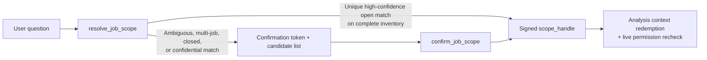

# Server-Authoritative Job Scope Resolution

An MCP server that sits in front of an applicant tracking system has to solve two distinct scoping problems before it runs an analytical query. The first is authorization scope: which requisitions the authenticated Greenhouse user is allowed to read at all. `packages/scoped-core/src/index.ts` enforces that boundary on every read. The second is intent scope: which subset of those permitted requisitions the user's current question is actually about. `packages/recruiter-mcp/src/resolvers/job-scope/` and `packages/recruiter-mcp/src/resolution/` enforce that second boundary.

## Why Model-Chosen Job IDs Are Not Enough

If the server only enforces authorization scope, a language model answering a question such as "how is our backend funnel moving?" has to call a job-search tool, guess which returned requisitions match the phrase, and pass those integer IDs into an analysis tool.

That pattern fails in two ways. For a recruiter with a narrow portfolio, a loose lexical match can quietly fold an older closed requisition or a similarly named role into the denominator of a conversion rate. For a site admin or an operator whose Greenhouse account can read every open requisition in the organization, an underspecified prompt can fan out across a broad role family or mix confidential, closed, and active requisitions without the user noticing.

Treating job scope as a server-side resolution step rather than a model-side search habit closes both gaps. Natural-language job references are accepted only by `resolve_job_scope` (or by `answer_my_recruiting_question`, which calls the same resolver before planning). Analysis tools such as `analyze_scorecard_accountability`, `analyze_interview_feedback_drag`, `analyze_stage_latency`, `analyze_pipeline_quality`, `analyze_source_quality`, and `analyze_rejection_reason_drift` reject free-text query parameters (`query`, `job_query`, `aliases`, `role_families`) at the input boundary.

## The Resolution Flow

When the model calls `resolve_job_scope` (`packages/recruiter-mcp/src/tools/job-scope/tools.ts`), the server loads the caller's permitted job inventory (`packages/recruiter-mcp/src/resolvers/job-scope/inventory.ts`), expands configured role aliases (`packages/recruiter-mcp/src/resolvers/job-scope/aliases.ts`), scores candidate requisitions deterministically (`packages/recruiter-mcp/src/resolvers/job-scope/resolver.ts`), and decides whether the match can proceed immediately or requires confirmation.

When a query resolves to a single open requisition with high confidence on a complete inventory, the resolver returns a signed `scope_handle` immediately — including for a site admin or operator with broad visibility (`kind: "all"`), where broad visibility is disclosed via `admin_scope` and a warning rather than gated behind confirmation. Whenever a query matches multiple requisitions, relies on a medium- or low-confidence match, or touches closed or confidential requisitions, the resolver withholds the `scope_handle` and returns a short-lived confirmation token alongside the candidate requisitions and warnings. Calling `confirm_job_scope` with the user's selected subset narrows the proposed set — it can never widen it beyond the jobs carried inside the confirmation token — and mints the `scope_handle`.

## Signed Scope Artifacts and Redemption

Both confirmation tokens and `scope_handle` values are built on the HMAC-SHA256 signing primitives in `packages/recruiter-mcp/src/resolution/artifacts.ts` and wrapped with job-scope payloads in `packages/recruiter-mcp/src/resolvers/job-scope/scope-handle.ts`. `ScopeHandlePayload` binds the token kind (`"scope_handle"`), the authenticated session subject (`sub`), the frozen list of job IDs (`jobs: number[]`), the scope hash (`hash: string`) and label, the inventory completeness flag (`complete: boolean`), and an expiration timestamp (`exp`). Verification uses `timingSafeEqual` over the digest bytes and rejects tampered payloads, expired handles, or handles presented by a different session subject.

A signed `scope_handle` freezes intent, not authorization. When an analysis tool redeems a handle through `resolveAnalysisContext` (`packages/recruiter-mcp/src/resolution/analysis-context.ts`), the server re-checks the caller's current Greenhouse job permissions against the handle's frozen `jobs` list before any recipe runs. If a recruiter has lost access to a requisition since the handle was minted, redemption fails closed rather than trusting the signature alone. If a caller passes explicit numeric `job_ids` instead of a `scope_handle`, `resolveAnalysisContext` loads the live permitted inventory and verifies every requested ID before the analysis proceeds; when both `scope_handle` and `job_ids` are supplied, `scope_handle` takes precedence and the response records a warning.

## Completeness as a Gate

Pagination truncation during job discovery cannot be allowed to masquerade as a clean match. If the underlying Harvest read for the caller's job inventory stops early because of a deadline or rate-limit error, the resolver marks `completeness.status` as `"incomplete"` (`packages/recruiter-mcp/src/resolvers/job-scope/resolver.ts`). Even if the partial pages happen to contain a single high-confidence match, the resolver returns candidate previews only, leaves `scope.job_ids` empty, and refuses to mint either a `scope_handle` or a confirmation token. And on the redemption side, `resolveAnalysisContext` rejects any handle where `payload.complete !== true` (`INVALID_REQUEST`).

## The Shared Resolver Framework

Job scope was refactored from a standalone module into the first concrete domain of a small internal framework under `packages/recruiter-mcp/src/resolution/`:

- `src/resolution/types.ts` defines the shared resolution vocabulary (`ResolverDomain`, `ResolutionResult`, `ConfidenceScore`, `ResolutionCompleteness`, and `UnresolvedEvidence`) so that confidence levels, truncation flags, and excluded-record counts have one representation across the server.
- `src/resolution/artifacts.ts` isolates the generic HMAC-SHA256 envelope signing and subject/expiry checks from job-specific payload fields.
- `src/resolution/services.ts` and `src/resolution/registry.ts` wire resolver dependencies into `src/runtime.ts` so the core runtime does not import from `src/tools/job-scope/*`. Only implemented domains (`job_scope`) are registered at runtime; unimplemented future domain literals are not stubbed with fake resolvers.
- `src/resolution/analysis-result.ts` defines `AnalysisResultEnvelope` and constructs the completeness and attribution envelopes attached to analysis outputs, turning pagination truncation or excluded rows into structured `"complete"`, `"partial"`, or `"incomplete"` statuses.

This framework is strictly server-side structure. The MCP catalog intentionally does not expose a generic catch-all resolver tool; model-facing tools stay concrete (`resolve_job_scope`, `confirm_job_scope`, `get_job_scope`, and the domain-specific `analyze_*` tools) while sharing the signing, completeness, and permission-revalidation machinery underneath.
