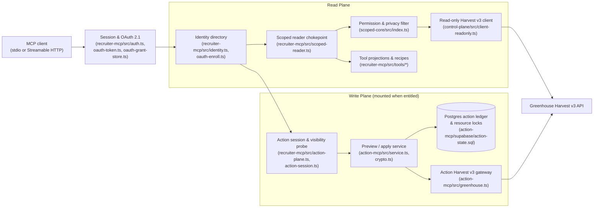

# Technical reference

This is the full technical description of the system, kept for engineers who want every mechanism, constant and file. Until 15 October 2026 it was the repository's README; the [README](../README.md) is now the short version.

Greenhouse MCP is a multi-package TypeScript workspace that lets recruiters and hiring operators work inside the Greenhouse applicant tracking system from Model Context Protocol (MCP) clients such as Claude Desktop, Claude Web, and Cursor.

## The Operating Problem

Connecting an AI assistant to an applicant tracking system creates two immediate failure modes if the server is a thin wrapper around the vendor API.

The first failure mode is read over-reach. In Greenhouse Harvest v3, every list endpoint requires a Site Admin authorizing user (`sub` on the OAuth 2.0 client-credentials token) and performs no per-recruiter row filtering on reads. A naive MCP server that holds a Harvest read credential therefore exposes the entire organization's candidate pipeline, compensation fields, private notes, and confidential requisitions to every connected user. Even within a single recruiter's permitted requisitions, handing raw candidate payloads or resume URLs to a language model risks leaking unrequested personal data or allowing prompt-injection text inside a resume to steer tool calls.

The second failure mode is write ambiguity. Mutating an applicant tracking system — moving an application across stages, rejecting a candidate, changing an owner, or updating an offer — has external consequences and cannot be safely driven by conversational confirmation alone. If a model calls a write endpoint directly, a stale read can overwrite another user's concurrent change, and a network timeout mid-flight leaves the caller guessing whether to retry a non-idempotent mutation.

This workspace solves both problems in server code rather than prompt instructions. Every recruiter read is resolved to an authenticated Greenhouse user and filtered to that user's live requisition permissions before any tool projection runs. Every write is off by default, gated per user and per client, and split into a read-only `preview_*` step that mints a short-lived cryptographic intent and a separate `apply_*` step that claims a Postgres resource lock and re-verifies live state before sending at most one mutation.

## How It Works



The workspace is organized into four packages under `packages/`:

| Package | `src/` files | `src/` lines (`wc -l`) | `test/` files | `test/` lines (`wc -l`) | Role |
|---|---:|---:|---:|---:|---|
| `packages/control-plane` | 17 | 5,438 | 17 | 6,717 | Unscoped operator MCP server and the shared read-only Harvest v3 HTTP/OAuth client (`src/client-readonly.ts` and its re-export shim `src/client.ts`, honoring `X-RateLimit-*` and `Retry-After` headers). |
| `packages/scoped-core` | 1 | 3,844 | 3 | 4,234 | Permission-scoping engine (`src/index.ts`) that resolves actor job permissions from `/v3/user_job_permissions` and `/v3/user_roles`, enforces default-deny row filtering and field projections across 70 registered read tools, and evaluates candidate privacy. |
| `packages/recruiter-mcp` | 119 | 55,656 | 126 | 46,074 | Hosted and local recruiter MCP runtime serving 82 read tools (4 scope and capability tools, 7 deterministic analytical tools, 1 bounded document reader, and 70 evidence readers), OAuth 2.1 with PKCE, roster enrollment, audit logging, and the mount point for the write plane. |
| `packages/action-mcp` | 33 | 6,948 | 17 | 6,769 | Two-phase preview/apply write engine defining 13 capabilities (26 tools), HMAC-SHA256 intent signing and state fingerprinting, Postgres-backed resource locking and idempotency ledger, readback verification, and out-of-band reconciliation. |

Across the entire staged repository there are 447 tracked files (`git ls-files | wc -l`), of which 372 are TypeScript or JavaScript source, script, and test files totaling 137,387 lines (`find . -type f \( -name "*.ts" -o -name "*.mjs" -o -name "*.js" \) | xargs wc -l`).

## Key Engineering Decisions and Where to Read Them

### Mechanical Read/Write Separation and Permission Scoping

The read plane cannot call write primitives because the module graph forbids it. `packages/control-plane/src/client-readonly.ts` (and its 3-line re-export shim `packages/control-plane/src/client.ts`) exports only `GET` primitives (`apiGet`, `apiGetWithCursor`, and `configure`) and handles HTTP 429 and retryable network failures using `X-RateLimit-Remaining`, `X-RateLimit-Reset`, and `Retry-After` headers. Write methods do not exist in `control-plane`; all mutations go through `createGreenhouseGateway` in `packages/action-mcp/src/greenhouse.ts`, which restricts outgoing writes to a fixed `MUTATION_PATHS` allowlist of 13 `[method, path]` routes. Inside `packages/recruiter-mcp`, `src/scoped-reader.ts` is the sole module allowed to import `control-plane/dist/client.js`. The static guard `packages/recruiter-mcp/scripts/verify-guards.mjs` (`runRecruiterPackageGuards`) fails verification if any recruiter module imports `action-mcp` outside the mount seam (`src/action-plane.ts` and `src/action-session.ts`), defines raw `POST`, `PATCH`, `PUT`, or `DELETE` calls, or imports the Harvest client outside `src/scoped-reader.ts`.

Every read passes through `createScopedGreenhouseReader` in `packages/scoped-core/src/index.ts`. Model-supplied parameters that resemble actor identity (`actor_id`, `on_behalf_of_user_id`, `actAsUser`, `actAsUserId`, and `user_id` where not part of a resource filter) are stripped before the raw request runs. `createHarvestPermissionProvider` (`packages/scoped-core/src/index.ts`) queries `/v3/user_job_permissions` and `/v3/user_roles` (joining `role_id` to `role_type === "site_admin"`), while `createSiteAdminAwarePermissionProvider` (`packages/recruiter-mcp/src/site-admin-permission.ts`) checks `/v3/users` (`site_admin: true`, `deactivated` not true) and computes confidential-job exclusions when a Site Admin is not assigned to a confidential requisition. By default permissions are cached for 60 seconds (`DEFAULT_PERMISSION_TTL_MS = 60_000` in `packages/recruiter-mcp/src/scoped-reader.ts`), and `GREENHOUSE_RECRUITER_FORCE_PERMISSION_TTL_ZERO=true` or `GREENHOUSE_RECRUITER_PERMISSION_TTL_MS=0` makes every read resolve them fresh; while a non-zero TTL is in force, `createTtlMemo` (`packages/recruiter-mcp/src/ttl-memo.ts`) coalesces concurrent in-flight lookups with subscriber refcounting and evicts on failure. Any tool name absent from `DEFAULT_FILTER_REGISTRY` (`70` entries) or any row whose job association cannot be established is denied by default.

Candidate privacy (`candidate.is_private`) and private custom fields (`custom_fields` entries marked private in `/v3/custom_fields`) are evaluated separately from job membership (`scoped-core` and `packages/recruiter-mcp/src/private-custom-fields.ts`). When an operator attestation is required and absent, private candidates are withheld (`packages/recruiter-mcp/src/private-candidate-attestation.ts`, `packages/recruiter-mcp/supabase/migrations/0008_private_candidate_attestation.sql`).

### Two-Phase Preview/Apply Write Protocol and Non-Retrying Reconciliation

`packages/action-mcp` exposes 13 fixed write capabilities (11 standard capabilities plus 2 opt-in interview capabilities, `interview_create` and `interview_update`, that remain unmounted unless listed in `GREENHOUSE_ACTION_CAPABILITIES`). There is no generic REST mutation tool and no model-chosen HTTP path or body.

A write begins with a `preview_<capability>` call handled by `GreenhouseActionService` (`preview` in `packages/action-mcp/src/service.ts`). Preview performs no mutation and never writes to the ledger store: it verifies the caller's session and preview entitlement, checks that every target record is visible through the caller's own scoped recruiter read path (`packages/recruiter-mcp/src/action-plane.ts`), reads current Greenhouse state via `definition.preparePreview`, computes keyed SHA-256 fingerprints (`fingerprintValue` in `packages/action-mcp/src/crypto.ts`), and returns `status`, `approval`, `intent`, and `expires_at`. The intent token is minted by `issueActionIntent` (`packages/action-mcp/src/crypto.ts`) as a version `2` `ActionIntent` envelope (`kind: "greenhouse_action_intent"`) signed with an HMAC-SHA256 key derived from `greenhouse-action:${domain}` (`domain = "intent"`) and a 5-minute TTL (`INTENT_TTL_MS = 5 * 60 * 1000`; `claim_greenhouse_action` in `packages/action-mcp/supabase/action-state.sql` rejects any intent whose lifetime exceeds 6 minutes). Its `ActionIntent` payload binds `actionId`, `actionKind`, `subject`, `identityId`, `actorUserId`, `attributionMode`, `sessionTokenId`, `client`, `applyTool`, `lockKey`, `scopeJobId`, `binding`, `currentFingerprint`, `desiredFingerprint`, `approvalFingerprint`, `highImpact`, `reconciliationGraceMs`, `issuedAtMs`, and `expiresAtMs`.

When the client invokes `apply_<capability>`, `GreenhouseActionService` (`apply` in `packages/action-mcp/src/service.ts`) verifies the signed intent via `verifyActionIntent` (`timingSafeEqual`), confirms that `fingerprintValue("approval", approval, ...)` matches `intent.approvalFingerprint`, re-verifies session revocation and current apply entitlement, and calls `claim_greenhouse_action` (`packages/action-mcp/supabase/action-state.sql`) before re-reading upstream state. `claim_greenhouse_action` serializes concurrent attempts on the target resource via the partial unique index `greenhouse_action_one_unresolved_per_lock` on `lock_key where status in ('executing', 'unknown')`. Once the claim succeeds, `apply` executes a fresh `definition.prepareApply`, re-verifies target visibility and session revocation, and compares the fresh `binding`, `currentFingerprint`, `desiredFingerprint`, and `approvalFingerprint` against the signed intent; if another user modified the record after preview, `assertPreparedMatches` aborts with `STATE_CHANGED` and finalizes the claim as `failed`. Otherwise, `apply` calls `begin_greenhouse_action_mutation` to take the row lock with a 120-second lease and sends at most one mutation through `packages/action-mcp/src/greenhouse.ts`.

Every mutation is followed by `observeWithDelays` readback against Greenhouse. Only when the mutation errors or times out, or when readback cannot confirm that the desired state landed, does `apply` record `status: "unknown"` with `UPSTREAM_RESULT_NOT_OBSERVED`, `UPSTREAM_RESULT_CONFLICT`, or `UPSTREAM_READBACK_FAILED` (`finish_greenhouse_action`), never retrying the business mutation. An out-of-band CLI, `greenhouse-action-reconcile` (`packages/action-mcp/src/reconcile-cli.ts`), later re-observes `unknown` rows using read-only Harvest calls with a separate OAuth client ID and transitions rows to `reconciled` or `failed` (or retains `unknown` with `observation = 'conflict'`) through `prepare_greenhouse_action_reconciliation`, `defer_greenhouse_action_unknown`, `reconcile_greenhouse_action_original_observation`, and `resolve_greenhouse_action_unknown`. `packages/action-mcp/supabase/action-state.sql` defines 2 tables (`greenhouse_action_entitlement` and `greenhouse_action`) and 7 RPC functions, and `packages/action-mcp/test/sql.test.ts` asserts that the schema stores only keyed hashes and operational metadata, never note bodies, candidate contact arrays, offer compensation values, or bearer tokens.

### OAuth 2.1 Session Lifecycle and Replay-Triggered Family Revocation

For hosted deployments, `packages/recruiter-mcp` implements an OAuth 2.1 authorization server (`src/oauth-authorize.ts`, `src/oauth-token.ts`, `src/oauth-grant-store.ts`, `src/oauth-metadata.ts`) that authenticates recruiters with Google OIDC, enforces PKCE (`S256`) and RFC 8707 resource indicators, and auto-enrolls first-time sign-ins when their verified work email matches an active Greenhouse user (`src/oauth-enroll.ts`).

Refresh tokens are single-use and tracked by grant family in `recruiter_mcp_oauth_grants` (`packages/recruiter-mcp/supabase/migrations/0006_oauth_authorization_grants.sql` and `0007_oauth_session_termination.sql`). The PL/pgSQL function `redeem_oauth_refresh` locks the presented row `FOR UPDATE`: on a valid first presentation it marks the row consumed and inserts the successor refresh grant in the same transaction; if a consumed refresh token is ever presented again, the function revokes the entire `family_id` and writes every access-token `jti` minted in that family into `recruiter_mcp_session_revocation`. Before minting a new access token on refresh, `handleRefreshTokenGrant` in `src/oauth-token.ts` peeks at the grant and re-queries `recruiter_identity_directory` to verify the recruiter is still enrolled and active; if the identity is missing or inactive, it calls `grantStore.revokeFamily(peek.familyId, ...)` on the presented grant family and revokes its access-token `jti` values before returning `invalid_grant` (while `greenhouse-recruiter-revoke-oauth` in `src/oauth-revocation-cli.ts` and roster reconciliation in `src/identity-reconciliation.ts` and `bin/greenhouse-recruiter-reconcile-identity.mjs` revoke across all grant families for a user).

### Server-Authoritative Scope Resolution and Deterministic Analytics

Analytical tools in `packages/recruiter-mcp/src/tools/` (`analyze_scorecard_accountability`, `analyze_interview_feedback_drag`, `analyze_stage_latency`, `analyze_pipeline_quality`, `analyze_source_quality`, `analyze_rejection_reason_drift`, and the multi-recipe planner `answer_my_recruiting_question`) do not accept free-text job queries and do not let the language model compute metrics from raw rows.

Instead, natural-language job references are resolved through `resolve_job_scope` and `confirm_job_scope` (`packages/recruiter-mcp/src/resolvers/job-scope/resolver.ts`, documented in [`docs/scope-resolution-and-resolver-framework.md`](../docs/scope-resolution-and-resolver-framework.md)). The resolver scores candidate requisitions deterministically and mints a signed `scope_handle` immediately when a single open requisition matches with high confidence on a complete inventory — including for a broad-visibility (`kind: "all"`) Site Admin or operator session, where broad visibility is disclosed via `admin_scope` and a warning rather than gated behind confirmation. Explicit confirmation via `confirm_job_scope` is required when a match is ambiguous or multi-requisition, or when it touches closed or confidential requisitions. The resolver refuses to mint an analyzable handle from a truncated job inventory, and `ScopeHandlePayload` (`packages/recruiter-mcp/src/resolvers/job-scope/scope-handle.ts`) binds the subject (`sub`), `jobs: number[]`, and `complete: boolean`. At analysis redemption, `resolveAnalysisContext` (`packages/recruiter-mcp/src/resolution/analysis-context.ts`) rejects any handle where `payload.complete !== true` (`INVALID_REQUEST`) and re-checks the frozen `jobs` list against live Greenhouse permissions. Each analytical tool then fetches the scoped records through `src/read-all.ts` (described in [`docs/harvest-v3-and-live-read-architecture.md`](../docs/harvest-v3-and-live-read-architecture.md)), computes rates, medians, and attribution counts in TypeScript (`src/facts.ts`, `src/metrics.ts`), and returns a structured `AnalysisResultEnvelope` (`packages/recruiter-mcp/src/resolution/analysis-result.ts`).

### Subprocess-Isolated Document Extraction

Candidate tools (`get_my_candidate`, `search_my_candidates`) never return resume contents or signed download links; `search_my_attachments` returns attachment metadata (`id`, `filename`, `type`, `created_at`) so the caller can select an `attachment_id`, and document text comes only through `read_my_resume` (`packages/recruiter-mcp/src/tools/resume.ts`). Given a single positive `attachment_id`, `runReadMyResume` performs a fresh scoped attachment lookup and requires that the `attachment_id` match a single attachment on a visible candidate (resumes, cover letters, take-homes, and offer packets on a visible candidate can all be read when explicitly selected by `attachment_id`). `validateDownloadUrl` enforces `https:`, default/443 port, no URL credentials, no IPv4 or IPv6 literals, and no `localhost`, `.localhost`, `.local`, or `.internal` hostnames, and a manual redirect loop follows up to 3 (`RESUME_MAX_REDIRECTS = 3`) same-origin redirects while re-validating every hop and stripping headers. The server streams at most 10 MiB (`RESUME_DOWNLOAD_MAX_BYTES = 10 * 1024 * 1024`) within a 30-second wall-clock tool budget (`HARD_MAX_TOOL_DURATION_MS = 30_000`), and parses PDF or DOCX bytes inside a spawned child Node process (`spawn` with `--max-old-space-size=96` and `--max-semi-space-size=16` running `packages/recruiter-mcp/src/resume-parser-worker.mjs`) monitored by 50 ms RSS polling capped at 192 MiB (`RESUME_PARSER_MAX_RSS_BYTES`), returning at most 200,000 UTF-8 bytes of extracted text (`RESUME_TEXT_MAX_BYTES = 200_000`) tagged as untrusted candidate-authored content.

## How Correctness Is Verified

Root `npm run verify` runs `npm run build && npm run typecheck --workspaces --if-present && npm test --workspaces && npm run guard --workspaces --if-present`:

1. `npm run build` compiles `@greenhouse-mcp/control-plane` and `@greenhouse-mcp/action-mcp` with `tsc`.
2. `npm run typecheck --workspaces --if-present` runs `tsc --noEmit` in `scoped-core`, `recruiter-mcp`, and `action-mcp`.
3. `npm test --workspaces` runs the test suites across all 4 packages via `tsx --test`.
4. `npm run guard --workspaces --if-present` runs the package verification gates in `recruiter-mcp` (`node scripts/verify-package.mjs && node scripts/check-harvest-v3-registry.mjs`) and `action-mcp` (`node scripts/verify-package.mjs`).

In `packages/recruiter-mcp`, `scripts/verify-package.mjs` calls `runRecruiterPackageGuards` in `scripts/verify-guards.mjs`, which enforces 4 static boundaries over `packages/recruiter-mcp/src/`: `assertRecruiterRuntimeIsReadOnly` (no `action-mcp` imports outside `src/action-plane.ts` and `src/action-session.ts`, and no raw write methods), `assertRawClientImportBoundary` (`src/scoped-reader.ts` is the sole importer of `control-plane/dist/client.js`), `assertEvidencePayloadHygieneCentralized` (forbidden field stripping centralized in `src/tools/evidence-projection.ts`), and `assertPackageBinsPresentAndExecutable`. Alongside the static guard, `test/catalog-registrar.test.ts` and `src/container-self-check.ts` verify the 82-tool catalog order and reject missing, duplicate, reordered, or unexpected tools during `npm test`.

In `packages/action-mcp`, `scripts/verify-package.mjs` statically verifies that `ACTION_KINDS` and `ACTION_DEFINITIONS` define the 13 capabilities (13 preview tools and 13 apply tools), that `src/greenhouse.ts` contains the 13 fixed `MUTATION_PATHS` patterns, that `src/service.ts` re-checks `assertTargetsVisible` and `assertNotRevoked` in the fresh preflight after `assertPreparedMatches`, that `src/index.ts` does not re-export `greenhouse.js`, that `supabase/action-state.sql` defines both RLS-enabled tables (`greenhouse_action_entitlement` and `greenhouse_action`) and all 7 RPC functions (`claim_greenhouse_action`, `begin_greenhouse_action_mutation`, `finish_greenhouse_action`, `prepare_greenhouse_action_reconciliation`, `defer_greenhouse_action_unknown`, `reconcile_greenhouse_action_original_observation`, and `resolve_greenhouse_action_unknown`) with no sensitive columns, and that `packages/action-mcp/README.md` lists all 35 required `harvest:*` scopes. `packages/action-mcp/test/sql.test.ts` asserts the SQL ledger contract as text during `npm test`, while `packages/action-mcp/deploy/sql-smoke-test.mjs` (`npm --workspace @greenhouse-mcp/action-mcp run smoke:sql`) is a standalone script that applies `supabase/action-state.sql` to a disposable Postgres instance outside `npm run verify`.

In addition to unit and integration tests, `packages/recruiter-mcp/test/harvest-contract-conformance.test.ts` and `packages/recruiter-mcp/test/support/harvest-contract.ts` test the read plane against a contract-checked fake Harvest server backed by `src/harvest-v3-registry.generated.ts` (72 GET endpoints).

Running `npm run verify` from a fresh clone executes 2,536 tests across 361 suites in the 4 workspace packages (`tsx --test` summary counts):

| Workspace package | Suites | Tests | Passed | Failed | Skipped | Notes on skipped items |
|---|---:|---:|---:|---:|---:|---|
| `@greenhouse-mcp/control-plane` | 67 | 303 | 303 | 0 | 0 | — |
| `@greenhouse-mcp/scoped-core` | 34 | 221 | 221 | 0 | 0 | — |
| `@greenhouse-mcp/recruiter-mcp` | 238 | 1,819 | 1,818 | 0 | 1 | 1 test in `test/resolution-framework.test.ts` skips because the optional design-notes directory is not part of this snapshot; 1 `describe` suite in `test/harvest-contract-conformance.test.ts` skips when the optional `docs/harvest-v3-api` vendor mirror is not present on disk. |
| `@greenhouse-mcp/action-mcp` | 22 | 193 | 193 | 0 | 0 | `deploy/sql-smoke-test.mjs` (`npm --workspace @greenhouse-mcp/action-mcp run smoke:sql`) is available separately to apply `supabase/action-state.sql` against a disposable Postgres instance. |
| **Total** | **361** | **2,536** | **2,535** | **0** | **1** | Measured via `npm ci && npm run verify` on Node v24.8.0 / npm 11.6.0. |

## Running Verification from a Fresh Clone

No Greenhouse credentials, Supabase project, or network access to external APIs are required to build and verify the workspace.

```bash
npm ci
npm run verify
node packages/recruiter-mcp/scripts/verify-package.mjs
```

`npm run verify` runs `npm run build` (`control-plane` and `action-mcp`), `npm run typecheck --workspaces --if-present`, `npm test --workspaces`, and `npm run guard --workspaces --if-present`. `node packages/recruiter-mcp/scripts/verify-package.mjs` runs `runRecruiterPackageGuards` (`packages/recruiter-mcp/scripts/verify-guards.mjs`) directly.

## Further Reading

- [`docs/scope-resolution-and-resolver-framework.md`](../docs/scope-resolution-and-resolver-framework.md) — why natural-language job queries resolve into signed, subject-bound `scope_handle` artifacts before any analytical recipe runs.
- [`docs/harvest-v3-and-live-read-architecture.md`](../docs/harvest-v3-and-live-read-architecture.md) — how Harvest v3's Site Admin list rule, cursor pagination, and schema shifts shape `scoped-core`, why the read plane queries Greenhouse live rather than through a general warehouse mirror, and how the optional weekly stage-stock snapshot (`pipeline_state_snapshot`) works.
- [`packages/recruiter-mcp/README.md`](../packages/recruiter-mcp/README.md) — recruiter catalog, transports, OAuth and session operations, and container entrypoint.
- [`packages/action-mcp/README.md`](../packages/action-mcp/README.md) — write capability catalog, preview/apply flow, runtime flags, and operator reconciliation commands.
- [`packages/scoped-core/README.md`](../packages/scoped-core/README.md) — `ActorResolver`, `PermissionProvider`, and `RawReadClient` ports and default-deny filtering rules.
- [`packages/control-plane/start-here.md`](../packages/control-plane/start-here.md) — running the unscoped operator control-plane server locally.

## What This System Deliberately Does Not Do

- It does not expose a generic Harvest write tool or allow the model to choose HTTP methods, endpoint paths, or raw JSON mutation bodies; writes are restricted to the 13 typed preview/apply capability pairs in `packages/action-mcp` and the 13 routes in `MUTATION_PATHS` (`packages/action-mcp/src/greenhouse.ts`).
- It does not perform bulk mutations across multiple applications, candidates, or requisitions in a single action; every preview and apply targets one resource and claims one resource lock key.
- It does not automatically retry an `apply_*` mutation whose outcome is ambiguous (timeout, transport error, HTTP 408/5xx, or unconfirmed readback); ambiguous executions are parked as `unknown` for read-only reconciliation.
- It does not create calendar invites, send emails to candidates, or dispatch external notifications; the opt-in `interview_create` and `interview_update` capabilities record or update Greenhouse interview rows for calendar events that already exist (`external_event_id`).
- It does not maintain a local database mirror of Greenhouse candidates, applications, notes, or scorecards; the Supabase project holds only access-control directories, session/OAuth revocation state, the PII-free action ledger, and the optional aggregate stage-count snapshot.
- It does not return candidate home addresses, raw profile payloads, signed attachment URLs, or unrequested custom fields on recruiter read tools.

## How This Repository Was Built

This system was built by a recruiter directing AI coding agents under a discipline of written specifications, adversarial code and architecture reviews, static boundary guards, and live API verification against Greenhouse Harvest v3.

This repository is a curated public snapshot as of 15 October 2026, with private development history, tenant-specific configuration, and deployment-specific artifacts omitted.
